<a href="https://vanneberg.co.za">
  <picture>
    <source media="(prefers-color-scheme: dark)" srcset="assets/dark/header.svg">
    
  </picture>
</a>

  <a href="https://vanneberg.co.za"><picture><source media="(prefers-color-scheme: dark)" srcset="assets/dark/btn-site.svg"></picture></a>
  <a href="https://vanneberg.co.za/cv/"><picture><source media="(prefers-color-scheme: dark)" srcset="assets/dark/btn-cv.svg"></picture></a>
  <a href="https://www.linkedin.com/in/jacques-vdberg/"><picture><source media="(prefers-color-scheme: dark)" srcset="assets/dark/btn-linkedin.svg"></picture></a>
  <a href="mailto:jacques@visionlink.co.za"><picture><source media="(prefers-color-scheme: dark)" srcset="assets/dark/btn-email.svg"></picture></a>

I'm a software engineer at **Stanchion Payment Solutions**, where I work on payment and switching systems with Java and Postilion and lead development on our Software Platform. I'm also co-founder and head developer of **VisionLink Technologies**, building NFC digital business cards and the software behind them.

Outside of that I'm exploring AI development, scripting and smart home automation. Sometimes that means improving a workflow. Sometimes it means building an entire survival game.

Most of my client and product work lives in private repositories, so the full picture is on **[vanneberg.co.za](https://vanneberg.co.za)**, with a build journal for every project.

 

<picture>
  <source media="(prefers-color-scheme: dark)" srcset="assets/dark/h-experience.svg">
  
</picture>

<a href="https://vanneberg.co.za/#experience">
  <picture>
    <source media="(prefers-color-scheme: dark)" srcset="assets/dark/experience.svg">
    
  </picture>
</a>

  

<picture>
  <source media="(prefers-color-scheme: dark)" srcset="assets/dark/h-work.svg">
  
</picture>

  <a href="https://vanneberg.co.za/projects/software-platform/"><picture><source media="(prefers-color-scheme: dark)" srcset="assets/dark/project-software-platform.svg"></picture></a>
  <a href="https://vanneberg.co.za/projects/visionlink/"><picture><source media="(prefers-color-scheme: dark)" srcset="assets/dark/project-visionlink.svg"></picture></a>

  <a href="https://vanneberg.co.za/projects/visionlink-dashboard/"><picture><source media="(prefers-color-scheme: dark)" srcset="assets/dark/project-visionlink-dashboard.svg"></picture></a>
  <a href="https://vanneberg.co.za/projects/vaal-car-hire-website/"><picture><source media="(prefers-color-scheme: dark)" srcset="assets/dark/project-vaal-car-hire-website.svg"></picture></a>

  <a href="https://vanneberg.co.za/projects/mr-bio-website/"><picture><source media="(prefers-color-scheme: dark)" srcset="assets/dark/project-mr-bio-website.svg"></picture></a>
  <a href="https://vanneberg.co.za/projects/feral/"><picture><source media="(prefers-color-scheme: dark)" srcset="assets/dark/project-feral.svg"></picture></a>

  <a href="https://vanneberg.co.za/#projects"><picture><source media="(prefers-color-scheme: dark)" srcset="assets/dark/btn-all.svg"></picture></a>

 

<picture>
  <source media="(prefers-color-scheme: dark)" srcset="assets/dark/h-toolkit.svg">
  
</picture>

<picture>
  <source media="(prefers-color-scheme: dark)" srcset="assets/dark/toolkit.svg">
  
</picture>

  

<a href="https://vanneberg.co.za">
  <picture>
    <source media="(prefers-color-scheme: dark)" srcset="assets/dark/footer.svg">
    
  </picture>
</a>
